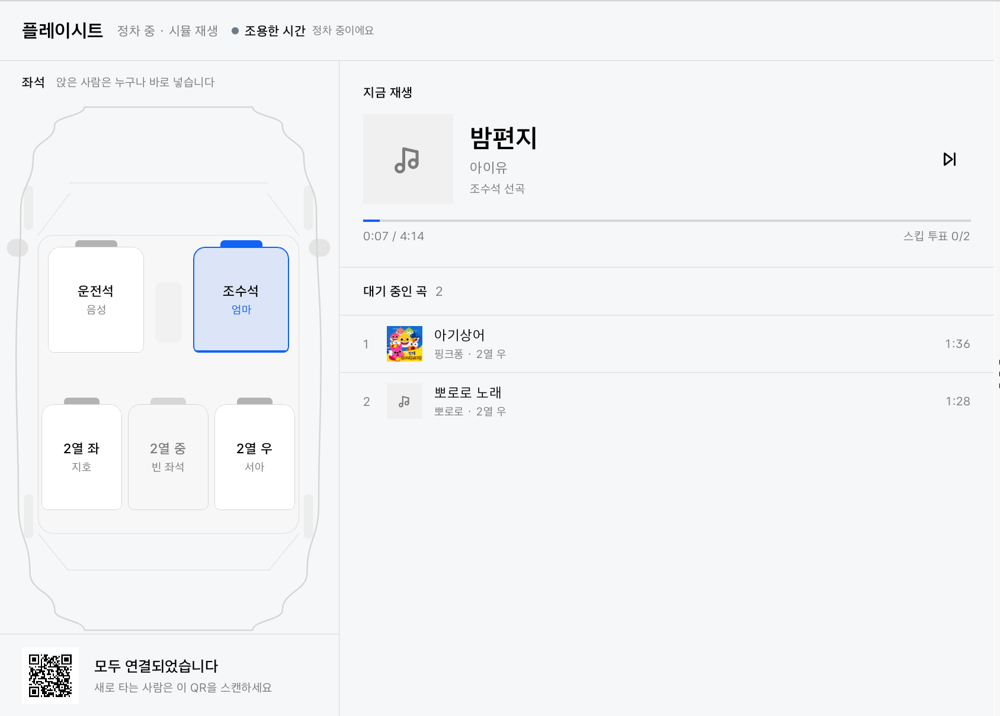
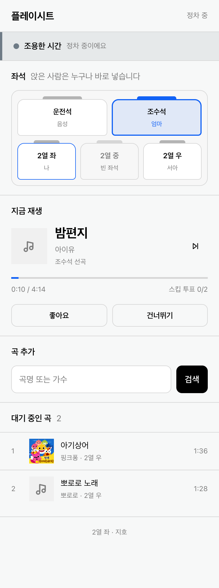

# 플레이시트 (PlaySeat)

차에 타는 순간 **모든 좌석이 DJ 부스가 되는** Pleos Connect 차량용 앱입니다.
좌석 착석 신호로 탑승자를 자동 인식해, 운전자와 동승자가 서로 다른 음악 앱을 쓰더라도
하나의 플레이리스트를 함께 만들고 함께 조작합니다.

현대자동차그룹 차량용 앱 개발 공모전 출품작 (대학(원)생 부문 · 팀 Semicolon).

| 차량 디스플레이 | 동승자 폰 |
|---|---|
|  |  |

전체 화면은 [`docs/screens/`](docs/screens/), 시연 영상은
[`docs/video/시연영상_플레이시트.mp4`](docs/video/시연영상_플레이시트.mp4) 에 있습니다
(1분 34초 · 에뮬레이터 실제 구동 화면).

## 한 줄로

> 차량의 음악은 사실상 운전자 한 사람의 것입니다. 그런데 그 운전자는 주행 중에
> 선곡을 하면 안 됩니다. **조작 권한(운전자)과 조작 가능성(동승자)이 어긋나 있습니다.**
> 플레이시트는 선곡권을 헤드유닛에서 좌석으로 분산하고, 운전자는 목소리로만 참여합니다.

## 핵심 동작

- **좌석이 곧 입장권** — 착석이 감지되면 그 좌석이 세션 슬롯이 됩니다. 초대·세션 개설
  절차가 없습니다. 폰은 최초 1회 QR 스캔만 하면 다음부터 자동 재연결됩니다. (`SEAT_OCCUPANCY`)
- **듣고 싶은 걸 그냥 넣는다** — 차례도, 좌석별 상한도 없습니다. 앉아 있으면 누구나,
  언제든, 몇 곡이든 넣습니다. 한 사람이 연달아 넣어도 막지 않습니다 — 같이 탄
  사람들은 서로 보고 있으므로 규칙보다 눈치가 먼저 작동하고, 그래도 불만이면
  스킵 투표(과반·최소 2표)가 있습니다. 곡마다 **어느 좌석이 골랐는지** 가 남고,
  지금 나오는 곡을 고른 자리가 좌석도에서 파랗게 켜집니다.
- **주행하면 조작 권한이 이사한다** — 주행 중 운전자 화면은 '지금 곡 + 버튼 2개'로 축약되고,
  검색·목록·키보드가 잠깁니다. 잠긴 권한은 동승자 폰으로 이전됩니다. 운전자는 음성으로만
  참여합니다. (`GEAR_SELECTION` · STT/TTS)
- **분위기를 차에서 읽는다** — 와이퍼가 움직이면 비, 전조등이 켜지면 어둠, 조향이 계속
  흔들리면 굽잇길. 날씨 API도 지도 API도 쓰지 않습니다. 판정 결과는 화면 배경·폰 배경·
  **실내 앰비언트 조명** 세 곳에서 같은 색으로 나타나고, 주행 중에는 운전자 화면 맨 위에
  큰 띠로 붙습니다 — 운전자는 화면을 읽지 않고 흘깃 보기 때문입니다.
  (`WINDSHIELD_WIPERS_SWITCH` · `EXTERIOR_LIGHTS_MODE` · `PERF_STEERING_ANGLE`)
- **아무도 안 넣으면 차가 권한다** — 재생과 큐가 모두 12초 비면 분위기에 맞는 곡을
  권하고, 20초 카운트다운 뒤 자동으로 담습니다. 누구든 멈출 수 있습니다.
- **경로에 맞춰 끝나는 플레이리스트** — 잔여 ETA에 큐 길이를 맞추고, 도착 5분 전부터
  랜딩 구간으로 들어갑니다. (NaviHelper)
- **도착하면 남는 것** — 드라이브 앨범 카드가 각자 폰으로 전달됩니다.

음원을 직접 재생하지 않습니다. 선곡은 '요청'으로 모으고, 실제 재생은 AAOS 표준
MediaSession/MediaController로 차량의 음악 앱에 위임하는 구조입니다.
음원 라이선스를 자체 보유하지 않으므로 저작권 리스크 없이 단계적으로 확장할 수 있습니다.

## 지금 어디까지 동작하는가

적혀 있다고 동작하는 것은 아니므로, 확인한 범위를 그대로 적습니다.

| 영역 | 상태 | 확인 방법 |
|---|---|---|
| 좌석 착석 → 세션 슬롯 | **에뮬레이터 실기 동작** | Virtual Console 로 `SEAT_OCCUPANCY` 주입 |
| 기어 → 주행/정차 UI 전환 | **에뮬레이터 실기 동작** | 기어 D/P 주입 |
| 충전 → 라운지 모드 | **에뮬레이터 실기 동작** | 충전구·충전 스위치 주입 |
| 와이퍼·전조등·조향 → 분위기 판정 | **에뮬레이터 실기 동작** | 신호별 주입, 앰비언트 조명 색 변화까지 확인 |
| 좌석 권한·스킵 과반·좌석 프로필(아동 제한) | 동작 | 단위 테스트 (차량 55 / 허브 32, 전부 통과) |
| 분위기 추천·자동 담기 | 동작 | 단위 테스트 + 실기 |
| 곡 검색 (큐레이션 74곡 + Deezer 보완) | 동작 | 단위 테스트 + 검색어 실측 |
| 드라이브 앨범 | 동작 | 실기 |
| 운전자 음성 조작 | 동작 (Android 표준 TTS/STT) | 실기 |
| ETA → 큐 길이·랜딩 구간 | **부분** — NaviHelper 연결·리스너 등록까지. 실제 경로 주행 미검증 | 에뮬레이터 기본 위치가 국내가 아니라 경로를 만들지 못했습니다 |
| 재생 | **시뮬레이션** — 시간만 흐릅니다. MediaSession 위임은 미구현 | 설계상 2단계 |

마지막 두 줄은 일부러 남겨 둔 것입니다. 없는 신호를 쓰는 척하면 실차에서 그 기능만
조용히 죽습니다. 같은 이유로 외기온(`ENV_OUTSIDE_TEMPERATURE`)은 VHAL 에는 있지만
SDK 공개 API 에 없어서 쓰지 않았습니다.

## 직접 돌려 보기

### 차량 앱 없이 (터미널 2개, 1분)

```bash
cd hub-server && ./gradlew run          # 허브 + 동승자 웹 (8080)
node demo/mock-car.mjs                  # 차량 앱 목. d=주행전환 1~5=좌석토글 n=다음곡
```

브라우저로 `http://localhost:8080` 을 열고 좌석을 고른 뒤 곡을 검색해 추가합니다.
`d` 를 누르면 조작 권한이 폰으로 넘어오는 동작을 볼 수 있습니다.

### 에뮬레이터로 (실제 차량 신호)

```bash
# 1. Pleos Connect AVD 실행 후
adb install -r --user 10 "apk/Semicolon_플레이시트_release.apk"
adb shell am start --user 10 -n dev.semicolon.playseat.car/.MainActivity
adb forward tcp:8088 tcp:8088           # Virtual Console

# 2. 허브
cd hub-server && ./gradlew run

# 3. 시연 시나리오 자동 실행 (약 4분, 손으로 누를 것 없음)
node demo/scenario.mjs
```

디스플레이는 **사용자 10번**에 붙어 있습니다. 기본 사용자(0번)에 설치하면 화면에 뜨지 않습니다.

| 스크립트 | 하는 일 |
|---|---|
| `demo/scenario.mjs` | 탑승 → 추천 → 선곡 → 주행 → 비 → 터널 → 굽잇길 → 도착 → 충전 라운지 자동 재생 |
| `demo/record.mjs` | 차량 화면과 폰 화면을 같은 시각 기준으로 동시 녹화 |
| `demo/compose.py` | 녹화본을 자막 얹은 한 편으로 편집 (가로 시연영상 + 세로 숏폼) |
| `demo/shots.mjs` | 화면 시안 13장을 같은 장면에서 다시 찍기 |
| `demo/console.mjs` | Virtual Console 신호 주입 (`--probe` 로 주입 가능 항목 확인) |
| `demo/mock-car.mjs` | 에뮬레이터 없이 차량 앱 흉내 |

시연 영상은 손으로 편집하지 않습니다. `scenario.mjs` 가 장면이 바뀐 시각을
`cues.json` 에 남기고 `compose.py` 가 그 시각으로 자르기 때문에, 다시 녹화해도
같은 편집이 그대로 나옵니다.

### 빌드와 테스트

```bash
cd car-app
echo "sdk.dir=$HOME/Library/Android/sdk" > local.properties
./gradlew :app:testDebugUnitTest :app:assembleRelease

cd ../hub-server && ./gradlew test
```

서명 키(`car-app/keystore.properties`, `*.jks`)는 저장소에 없습니다.
키가 없으면 서명 없는 release APK 가 만들어집니다 — 빌드는 됩니다.

## 저장소 구조

| 경로 | 내용 |
|---|---|
| `car-app/` | Android 차량 앱 (Kotlin, Jetpack Compose, Pleos Connect SDK) |
| `hub-server/` | Ktor WebSocket 허브 — 중계 · 곡 검색 · 분위기별 추천 |
| `passenger-web/` | 동승자 웹앱 (설치 불필요, QR로 진입) |
| `demo/` | 시연 시나리오·화면 캡처·Virtual Console 자동화 |
| `contract/` | 차량 앱 ↔ 서버 ↔ 웹앱 통신 계약 (v0.6) |
| `apk/` | 제출용 release APK |
| `docs/screens/` | 화면 시안 |
| `docs/` | 환경·검증·남은 일 |

규모: 차량 앱 3,457줄 + 테스트 915줄 / 허브 957줄 + 테스트 275줄 / 웹 812줄 / 시연·녹화 2,417줄.
테스트 87개 전부 통과 (차량 55 · 허브 32).

## 설계에서 지킨 것

1. **차량 앱이 단일 진실 공급원입니다.** 허브는 중계·검색·추천만 하고 판정하지 않습니다.
   동승자 웹은 `state.sync` 를 그대로 그립니다 — 턴 순서나 스킵 과반을 폰에서 계산하지
   않고, 낙관적 업데이트도 하지 않습니다. 양쪽이 같은 것을 두 번 계산하면 반드시 어긋납니다.
2. **차량 SDK 는 `vehicle/`·`voice/` 패키지 안에만 들어갑니다.** 세션 엔진은 값 객체만
   받으므로 에뮬레이터 없이 모든 조합을 단위 테스트로 돌립니다.
3. **차량 화면과 폰 화면이 같은 디자인 언어를 씁니다.** 색·면 나누는 방식·타이포를
   Pleos 시스템 UI 에서 뽑아 양쪽에 같이 적용했습니다. 헤드유닛은 앱 하나를 쓰는
   기기가 아니라서, 우리 앱만 다른 언어를 쓰면 '나중에 얹은 것'으로 보입니다.
4. **주행 중 제약을 기능으로 바꿉니다.** 주의 분산 규제를 피해야 할 제약이 아니라,
   '옆 사람에게 넘긴다'는 설계의 근거로 씁니다. `distractionOptimized` 를 선언하고
   주행 중 터치 타깃을 2개로 제한합니다.

## 문서

- 통신 계약: [`contract/protocol.md`](contract/protocol.md) — 맨 앞의 구현 상태표를 먼저 보세요
- 에뮬레이터 환경 구성: [`docs/SETUP.md`](docs/SETUP.md)
- 실기 검증 기록: [`docs/VERIFY.md`](docs/VERIFY.md)
- 남은 일과 담당: [`docs/REMAINING.md`](docs/REMAINING.md)
- 작업 규칙: [`CONTRIBUTING.md`](CONTRIBUTING.md)
